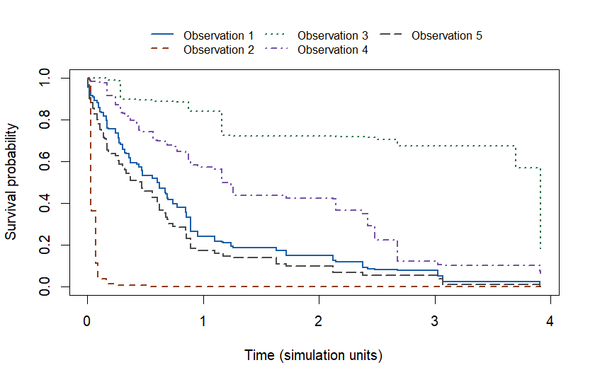

<!-- Generated by tools/build-getting-started.R; edit getting-started.R. -->
<!-- Source MD5: c3cc00dacf71a454483fe9e9e52d01c5 -->
<!-- orthoDr 2.0.0; R 4.6.1; 2026-10-26 -->

## Version and installation

These tutorials use **orthoDr 2.0.0**, available from GitHub.
The CRAN release is 0.6.8. For results matching these tutorials, install
the GitHub version; see the [release notes](https://teazrq.github.io/orthoDr/news/index.html)
for changes between versions.

Install the development package in your usual R user library:

```r
install.packages("remotes") # once, if needed
remotes::install_github("teazrq/orthoDr")
```

Installing from GitHub requires a C++ compiler supported by R, such as
[Rtools on Windows](https://cran.r-project.org/bin/windows/Rtools/).

To use the CRAN release instead, run `install.packages("orthoDr")` and
consult the [CRAN reference manual](https://cran.r-project.org/web/packages/orthoDr/refman/orthoDr.html).

Download the [complete R script](https://teazrq.github.io/orthoDr/examples/getting-started.R)
to run all four examples. Last digits and iteration counts can vary by platform.


``` r
library(orthoDr)
packageVersion("orthoDr")
#> [1] '2.0.0'
```

## Fit a regression model and predict

Estimate one linear combination of four predictors, then use it to predict
a continuous response. The simulated conditional mean is $x_1 + 0.2x_2$,
so one direction is sufficient for this example.

Supply a numeric matrix with one row per observation and one column per
predictor, together with a response vector in the same row order.


``` r
set.seed(101)
x_reg <- matrix(rnorm(120 * 4), ncol = 4)
y_reg <- x_reg[, 1] + 0.2 * x_reg[, 2] + rnorm(120, sd = 0.3)
new_x <- matrix(rnorm(5 * 4), ncol = 4)
```

### Fit and interpret the reduced predictor

`ndr = 1` requests one direction; the function does not select this number
for you. `keep.data = TRUE` retains the training observations needed for
subsequent prediction. Here we use semiparametric sliced inverse regression
(`method = "sir"`).


``` r
reg_fit <- orthoDr_reg(
  x_reg, y_reg, method = "sir", ndr = 1,
  keep.data = TRUE, maxitr = 200, ncore = 1
)
dim(reg_fit$B)
#> [1] 4 1
reduced_x <- x_reg %*% reg_fit$B
round(head(reduced_x), 3)
#>        [,1]
#> [1,] -0.423
#> [2,]  0.457
#> [3,] -0.941
#> [4,]  0.153
#> [5,]  0.379
#> [6,]  1.048
reg_fit$converge
#> [1] TRUE
```

The four entries in `B` are weights defining one reduced predictor. Each row
of `reduced_x` is the weighted combination for one training observation.
These weights describe a subspace, rather than coefficients in a regression
equation for the response. A direction can change sign, and a basis with
several directions can rotate while spanning the same subspace.

`converge = TRUE` means a numerical stopping criterion was reached.
If it is `FALSE`, check `reg_fit$itr` against `maxitr` and rerun with
`verbose = 1` to inspect progress before using the fit.

### Predict responses for new observations

New rows must contain the same predictors in the same order and units.
`pred` gives one estimated conditional mean for each new row.


``` r
reg_prediction <- predict(reg_fit, new_x)
round(data.frame(
  predicted_mean = reg_prediction$pred,
  simulated_mean = new_x[, 1] + 0.2 * new_x[, 2]
), 3)
#>   predicted_mean simulated_mean
#> 1         -0.617         -0.891
#> 2         -0.836         -1.039
#> 3         -0.172         -0.152
#> 4         -0.650         -0.794
#> 5         -0.312         -0.332
```

The simulated mean is known because we generated these data. This small
table illustrates the prediction output; it is not a performance comparison.

### Reuse training preprocessing

If you standardize predictors before fitting, apply the training means and
standard deviations to new observations. Do not standardize each new batch
separately. For example, prepare these matrices before fitting and predicting:


``` r
scaled_x <- scale(x_reg)
scaled_new_x <- scale(new_x,
  center = attr(scaled_x, "scaled:center"),
  scale = attr(scaled_x, "scaled:scale")
)
```

Fit on `scaled_x` and pass `scaled_new_x` to that fit's `predict()` call.
The fit above used unscaled predictors, so its predictions use `new_x`.

## Fit a survival model and predict curves

Estimate how the probability of remaining event-free changes over time for
new observations. Observed time is the minimum of event and censoring times. An event
indicator of **1 means an event**, and 0 means censoring. We use the
martingale estimating equation, `method = "dm"`. Event times in this
simulation depend on the first predictor, so we request one direction.


``` r
set.seed(102)
x_surv <- matrix(rnorm(120 * 4), ncol = 4)
event_time <- rexp(120, rate = exp(x_surv[, 1]))
censor_time <- rexp(120, rate = 0.3)
observed_time <- pmin(event_time, censor_time)
event <- as.integer(event_time <= censor_time)
new_surv_x <- matrix(rnorm(5 * 4), ncol = 4)
```

### Fit and predict survival probabilities


``` r
surv_fit <- orthoDr_surv(
  x_surv, observed_time, event, method = "dm", ndr = 1,
  keep.data = TRUE, maxitr = 200, ncore = 1
)
surv_prediction <- predict(surv_fit, new_surv_x)
dim(surv_prediction$surv)
#> [1] 91  5
head(surv_prediction$timepoints)
#> [1] 0.001435511 0.002411730 0.003128249 0.013880143 0.013921950 0.016101402
range(surv_prediction$surv)
#> [1] 6.004596e-24 1.000000e+00
surv_fit$converge
#> [1] TRUE
```

The survival matrix has one column per new subject and one row per observed
event. `timepoints` gives those row times. Probabilities lie between 0 and 1
and decrease or stay constant over time. Tied events
share a time label and the same post-event probability.

### Read the predicted curves

Each curve below belongs to one of the five new observations. At a given
time, its height is the estimated probability of remaining event-free.


``` r
curve_colors <- c("#1C5FA8", "#8C3B19", "#25734A", "#7851A9", "#4A4A4A")
matplot(
  c(0, surv_prediction$timepoints),
  rbind(rep(1, ncol(surv_prediction$surv)), surv_prediction$surv),
  type = "s", lty = 1:5, col = curve_colors, lwd = 2,
  xlab = "Time (simulation units)", ylab = "Survival probability",
  ylim = c(0, 1)
)
legend("top", legend = paste("Observation", 1:5),
       col = curve_colors, lty = 1:5, lwd = 2, bty = "n",
       ncol = 3, inset = c(0, -0.22), xpd = NA, cex = 0.85)
```

<div class="figure">

<p class="caption">Predicted survival probabilities for five new observations in the simulated example.</p>
</div>

These curves describe predictions from this fitted model. Their shape alone
does not establish prediction accuracy. To view the training outcomes against
a reduced predictor, use `view_dr_surv()` instead. Its `FUN` argument transforms
time, for example `FUN = log` or `FUN = identity` to leave time unchanged.

## Learn a personalized dose and predict

Learn a dose rule from predictors, observed doses, and rewards. Larger
rewards must represent better outcomes. In this simulation, the mean reward is
$4 + x_1 - (a - 1 - 0.3x_2)^2$, and the dose maximizing it is $1 + 0.3x_2$.
The observed doses are between 0 and 2, and rewards in this example are positive.


``` r
set.seed(113)
x_dose <- matrix(runif(150 * 3, -1, 1), ncol = 3)
observed_dose <- runif(150, 0, 2)
target_dose <- 1 + 0.3 * x_dose[, 2]
reward <- 4 + x_dose[, 1] - (observed_dose - target_dose)^2 +
  rnorm(150, sd = 0.1)
new_dose_x <- matrix(runif(5 * 3, -1, 1), ncol = 3)
```

### Fit a dose rule directly

The direct method targets the dose rule. Its simulated target depends only
on $x_2$, so we use `ndr = 1`. The `K = 12` candidate doses and ridge
parameter `lambda = 0.1` initialize the rule. The fit then minimizes
negative estimated mean reward plus a squared coefficient penalty controlled by
`lambda.reward`. We set it to 0.1 here; this choice is not selected by GCV
and should be assessed together with the kernel bandwidth for your data.
We opt into `intercept = TRUE` to learn an unpenalized average dose and
penalize the centered kernel coefficients. The default is `FALSE`.


``` r
dose_fit <- orthoDr_pdose(
  x_dose, observed_dose, reward, method = "direct", ndr = 1,
  K = 12, lambda = 0.1, lambda.reward = 0.1, intercept = TRUE,
  keep.data = TRUE, maxitr = 500, ncore = 1
)
dose_fit$converge
#> [1] TRUE
data.frame(gradient_norm = dose_fit$gradient.norm)
#>           gradient_norm
#> B          4.366729e-07
#> W          2.149103e-11
#> intercept  3.069323e-12
#> policy     2.170910e-11
dose_fit$stop.reason
#> [1] "gradient_tolerance"
```

For this fit, `converge = TRUE` means that the joint policy residual and
direction gradient meet the numerical tolerance. The policy residual combines
the coefficient gradient with the intercept condition at its bounds.
If convergence is `FALSE`, inspect `stop.reason` and the residuals before using
the rule. A small
change between iterations alone does not establish convergence.


``` r
dose_fit$intercept
#> [1] 1.031176
dose_fit$intercept.bounds
#> [1] 0.02001571 1.97114651
```

`intercept` is the average fitted dose over the training predictors.
By default its bounds are the observed dose range. Supply
`intercept.bounds = c(lower, upper)` when a different mean-dose interval is
appropriate. These bounds do not restrict each individual prediction.


``` r
dose_prediction <- predict(dose_fit, new_dose_x)
```

### Fit the reward surface first

The pseudo-direct method first estimates the mean reward as a function of
dose and reduced predictors, then finds doses with high estimated reward.
Here that mean depends on both $x_1$ and $x_2$, so we use `ndr = 2`.
The two methods therefore use different dimensions for their different targets.


``` r
pseudo_fit <- orthoDr_pdose(
  x_dose, observed_dose, reward, method = "pseudo_direct", ndr = 2,
  K = 12, lambda = 0.1, keep.data = TRUE, maxitr = 150, ncore = 1
)
pseudo_prediction <- predict(pseudo_fit, new_dose_x)
pseudo_fit$converge
#> [1] TRUE
```

### Interpret predicted doses

`pred` contains one estimated dose for each new observation, in the units
of the observed doses. The known optimal dose is available only because
this is a simulation.


``` r
round(data.frame(
  direct = drop(dose_prediction$pred),
  pseudo_direct = drop(pseudo_prediction$pred),
  simulated_optimal = 1 + 0.3 * new_dose_x[, 2]
), 3)
#>   direct pseudo_direct simulated_optimal
#> 1  1.457         1.219             1.265
#> 2  0.995         0.870             0.971
#> 3  0.919         0.703             0.877
#> 4  0.919         0.837             1.171
#> 5  0.916         0.823             0.986
```

The direct method uses the candidate grid only to initialize its rule;
pseudo-direct learning uses it to construct the final ridge rule.
Final predictions come from a
continuous fitted rule, so they need not be grid points and are not constrained
to the observed dose range. This table illustrates the returned values, not
the relative performance of the methods. Numerical convergence does not
establish a globally optimal rule or its performance on new data.

## Use the general optimizer

Maximize $b^T A b$ subject to $b^T b = 1$, where $A = X^T X$.
This finds the first principal component of centered $X$. We provide the
analytic gradient $2 A b$ and compare the fitted subspace with `prcomp()`.


``` r
set.seed(104)
x_pca <- scale(matrix(rnorm(100 * 6), ncol = 6), scale = FALSE)
a_pca <- crossprod(x_pca)
b_initial <- matrix(rep(1 / sqrt(6), 6), ncol = 1)
objective <- function(b, a) drop(crossprod(b, a %*% b))
gradient <- function(b, a) 2 * a %*% b

optim_fit <- ortho_optim(
  b_initial, objective, gradient, a = a_pca,
  maximize = TRUE, maxitr = 500
)
pca_direction <- prcomp(x_pca)$rotation[, 1, drop = FALSE]
pca_distance <- distance(optim_fit$B, pca_direction, type = "dist")
round(pca_distance, 6)
#> [1] 0
round(drop(crossprod(optim_fit$B)), 6)
#> [1] 1
optim_fit$converge
#> [1] TRUE
```

A subspace distance near zero indicates agreement with `prcomp()`.
The squared length of the fitted direction should be 1.
If you omit `gradient`, the solver approximates it numerically.

## Reference and reproducibility

Use `help("orthoDr_reg")`, `help("orthoDr_surv")`, `help("orthoDr_pdose")`,
`help("predict.orthoDr")`, and `help("ortho_optim")` for your installed
version's argument and return-value documentation.

Use the [supplemental survival example](https://teazrq.github.io/orthoDr/examples/survival-optimizer.R)
to work with the bundled melanoma data and explore plots of a reduced predictor.
